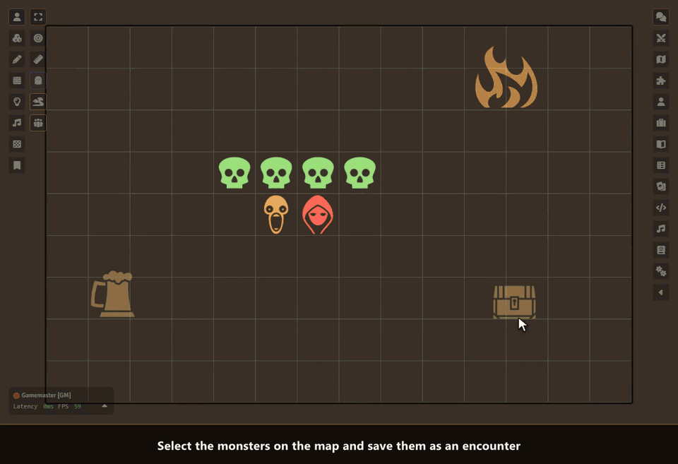

# Sephral’s Saved Encounters

**You spent twenty minutes setting up the goblin ambush on the bridge, and the players took the other road. Next session they finally walk into it, and you start dragging tokens again. Saved Encounters keeps that setup: save the monsters once and put the whole group back on any map with one click.**

## Highlights

* **Save what is on the map:** select the monsters, click once and they are kept with their formation, names, pictures, sizes and hidden state.
* **Place with a preview:** the group follows your mouse over the map as a ghost and snaps to the grid. A click sets it down, also on maps with another grid size, on hexes and on gridless maps.
* **Turn the group:** press Q or E while you place and the whole formation turns by 90 degrees. The encounter and its pin remember which way it faces.
* **Counts that roll:** give the goblins `1d4+1` and every placement brings a different war band. Extra monsters find free squares next to their friends.
* **Unique villains stay unique:** a named boss linked to his actor stands on a scene only once. Place the encounter again and he is left out with a short notice, while his goblins still come.
* **Straight from the compendium:** drop monsters from the sidebar or a compendium into an encounter. They are imported once when you first place them.
* **Place and fight:** one button sets the monsters down, adds them and the heroes on the scene to the combat and rolls initiative for the monsters.
* **Pins on the map:** mark where an encounter waits. Alt and a double click on the pin and the monsters appear right there.
* **Run it again:** remove the placed monsters or set it up fresh at the same spot.
* **Loot included:** link a roll table to an encounter and roll it after the fight, into Sephral’s Loot Ledger when you use it.

## How it works

1. Select the monsters of an encounter on the map and click *Save selected tokens as an encounter* in the token controls.
2. Give it a name, a count for each kind of monster and some notes, then save.
3. Open *Saved Encounters* from the token controls or the journal sidebar, click *Place* or *Place and fight*, turn the group with Q and E if you like and click where it should stand.

## Good to know

Encounters are journal entries in a folder only the GM sees, so players never find them. Put them into a compendium to use them in other worlds.

## Install

Search for **Saved Encounters** in Foundry's module browser or open the [package page](https://foundryvtt.com/packages/sephrals-saved-encounters).

Foundry VTT 13 and 14 · any game system · English and German

## Learn more

Every button, setting and the macro API are explained in the [manual](MANUAL.md). Questions or ideas? Join us on [Discord](https://discord.gg/7BjCgDYaBP). Looking for more? See [all modules by Sephral](https://github.com/Sephral).

## License

See [LICENSE.md](LICENSE.md).
